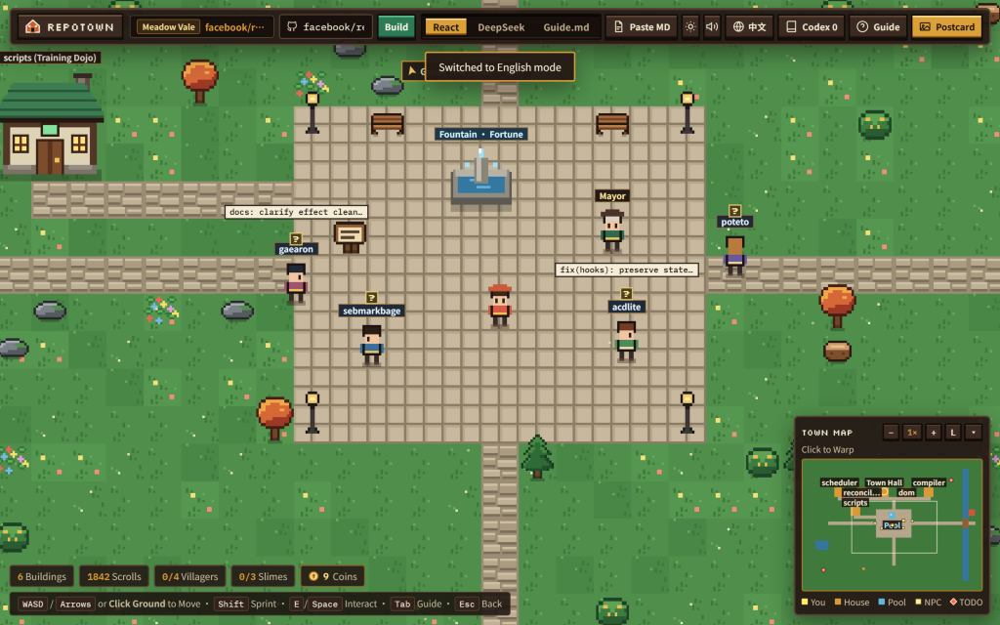
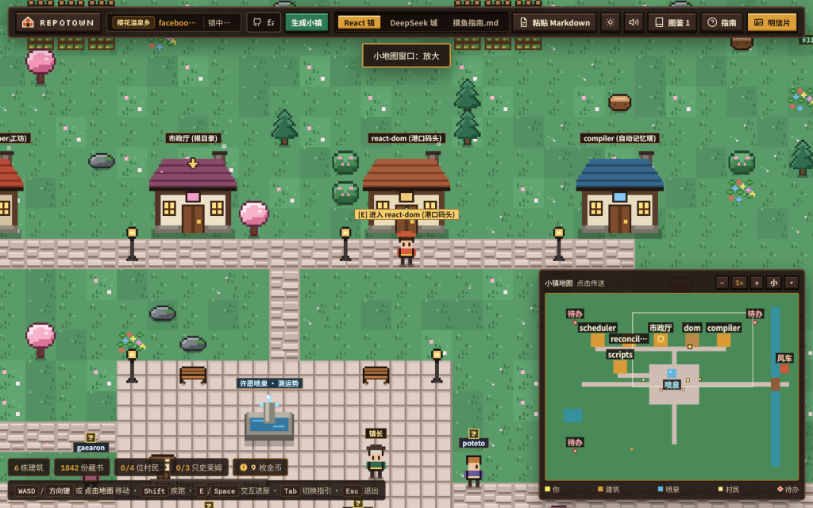

<div align="center">

# 🏘️ RepoTown

### Turn any GitHub Repository or Markdown file into a playable 2D Pixel RPG Town

**把任意 GitHub 仓库或 Markdown 文档，一键变成可走、可逛、可进屋、可打怪的 2D 像素 RPG 小镇**

<p>
  
  
  
  
</p>

[✨ Why RepoTown](#-why-repotown--项目缘起) • [🖼️ Live Previews](#️-preview--实机预览) • [🗺️ World Mapping](#️-how-code-becomes-a-town--仓库如何长成一座小镇) • [🎮 Gameplay](#-features--核心玩法与特性) • [🚀 Quick Start](#-quick-start--零构建快速启动)

</div>

---

## ✨ Why RepoTown · 项目缘起

> **测试Gemini4Neon做的一个小项目，全部由ai完成，我只负责测试体验问题。意外的挺好玩。本项目为全ai项目，人类基本没参与。**
>
> *Built to test Gemini4Neon — designed, coded, drawn in pixel art, and wired end-to-end 100% by AI, with human involvement limited to playtesting UX feedback. Surprisingly fun to explore!*

No `node_modules`, no bundler, no frameworks, and no sprite packs downloaded from anywhere: every pixel tile, seasonal palette, character animation, 8-bit sound effect, A* pathfinder, particle effect, and parchment UI dialog runs purely on **native browser ES Modules + HTML5 Canvas + WebAudio**.

---

## 🖼️ Preview · 实机预览

<table>
  <tr>
    <td width="50%" align="center">
      
      <br />
      <sub><b>English Mode · Meadow Vale</b> — Plaza Wishing Fountain, Committer NPCs, Dual-Row Interactive Minimap</sub>
    </td>
    <td width="50%" align="center">
      
      <br />
      <sub><b>简体中文模式 · 樱花温泉乡</b> — 推门进屋提示、放大可拖拽小地图、多季节随机生态风貌</sub>
    </td>
  </tr>
</table>

---

## 🗺️ How Code Becomes a Town · 仓库如何长成一座小镇

Paste any `owner/repo` (e.g. `facebook/react`, `vercel/next.js`) or drop a `.md` file onto the screen, and watch the structure come alive:

| Source Element · 源数据 | RPG World Entity · 小镇实体 | Interactive Behavior · 可交互玩法 |
| :--- | :--- | :--- |
| **Root & Top Folders** (`src/`, `packages/`, `scripts/`) | **Pixel Buildings** (Town Hall, Workshops, Harbor, Tower, Dojo) | Walk up & press `E` (or click) to enter interiors; roof colors & architecture adapt to folder role |
| **Source Files & Code Blocks** | **Bookshelves & Treasure Chests** | Inspect file metadata, preview live source syntax/code highlights, bookmark into your Codex, or jump to GitHub |
| **Git Contributors & Commits** | **Wandering Villagers (NPCs)** | Talk to recent committers to read commit messages/SHAs; click any yellow dot on the Minimap to teleport beside them |
| **Open Issues / Markdown `- [ ]`** | **Outskirts Slimes** | Raid overdue TODOs! Choose **Casual Raid** (`+1 Wishing Coin` right away) or **Dev Raid** (verifies issue closure on GitHub) |
| **Town Center Plaza** | **Wishing Fountain** | Toss `1 Wishing Coin` for a humorous Fortune Slip (`Grand Fortune [SSR]`, lucky house teleport, Dev Do/Skip advice) |
| **East Stream Bridge** | **Windmill Easter Egg** | Spin the sails for pixel petal/leaf bursts, chime harmonics, and hidden town trivia |
| **README.md & Repo Meta** | **Town Mayor & Noticeboard** | Read repository overview and project README inside a collapsible parchment reader |

---

## 🎮 Features · 核心玩法与特性

- **🌸 4 Random Town Biomes · 4 种季节生态风貌**：每次生成或导入项目，小镇都会在 **翠绿牧歌镇 (Meadow Vale)**、**樱花温泉乡 (Sakura Springs)**、**金秋枫叶村 (Autumn Maples)**、**凛冬雪原港 (Winter Harbor)** 四套全手绘像素调色板与环境粒子中随机切换。
- **⚔️ Dual Slime Raid + Wishing Coin Economy · 双模式史莱姆讨伐 & 许愿金币循环**：讨伐郊外待办史莱姆可切换「⚔ 普通讨伐 / Casual Raid」（点入返回即胜利，立即掉落 `+1 许愿金币`）与「开发者讨伐 / Dev Raid」（真实校验 GitHub Issue 关闭状态），再去镇中心喷泉掷币抽今日代码运势。
- **🧭 Zoomable & Draggable Interactive Minimap · 可缩放可拖拽小地图 & 传送光环**：支持 `1× ~ 3×` 视野缩放、窗口大小切换（小/中/大/折叠）、放大后拖拽平移，点击任意建筑、风车、村民或史莱姆即可伴随传送光环瞬移到达。
- **🐾 Click-to-Move A* Pathfinding & Cozy Interiors · 自动寻路与室内空间**：支持 `WASD` / 方向键与点击地面 A* 自动绕障寻路；房屋内部配有墙画、盆栽、书架、宝箱、地毯与**可坐下休息的长椅/椅子**，以及书架旁守候的管理员 NPC。
- **🌗 Day / Dusk / Night & 8-bit WebAudio · 昼夜光影与纯合成音效**：一键切换白昼 / 黄昏暖橙 / 月夜路灯照明，搭配 WebAudio 实时合成的脚步声、开门声、喷泉水花、风车风铃与讨伐音效。
- **📜 Parchment Transitions & Souvenir Postcard · 羊皮卷动效与全景明信片**：内置可展开羊皮卷放大阅读、5 步互动新手引导（带自动代跑传送助手）、探索图鉴 (`Codex`)，以及一键生成并下载 `.png` 小镇明信片。
- **🌐 Native Bilingual Mode · 启动自选 + 实时中英文切换**：每次打开支持选择 **简体中文 / English**，顶部随时一键切换全界面语言。

---

## 🎯 Controls · 操作指南

| Key / Input · 按键或操作 | Action · 功能 |
| :--- | :--- |
| `W A S D` / `↑ ↓ ← →` / **Click Ground** | Walk around town or auto-pathfind with A* · 移动或点击地面自动寻路 |
| `Shift` | Sprint · 疾跑加速 |
| `E` / `Space` / **Click Object** | Enter house, talk to NPC, raid slime, toss coin, sit on chair, spin windmill · 交互 / 进屋 / 坐下 |
| `Tab` | Cycle edge compass guide target to next unread landmark · 切换边缘罗盘指引目标 |
| `Esc` | Exit building / close parchment reader or dialog · 退出室内或关闭对话 |
| **Minimap Click / Drag** | Click dot to teleport with aura; zoom in (`+`) & drag to pan · 小地图点击瞬移 / 放大拖动 |

---

## 🚀 Quick Start · 零构建快速启动

Because RepoTown uses zero-dependency ES Modules (`<script type="module">`), any static HTTP server can launch it in seconds:

### Option 1 — Python (built-in)
```bash
git clone https://github.com/<your-username>/repotown.git
cd repotown
python -m http.server 8765
```
Open **`http://127.0.0.1:8765`** in your browser.

### Option 2 — Node.js / VS Code
```bash
npx serve . -l 8765
```
Or open with the **Live Server** extension in VS Code / Cursor / Antigravity.

> [!TIP]
> **Optional GitHub Rate-Limit Helper:** Unauthenticated GitHub API requests allow 60 calls/hour. If you explore dozens of repositories rapidly, click the token prompt to store a read-only Personal Access Token in `sessionStorage` (cleared automatically when the tab closes). Preset towns and local Markdown drag-and-drop require **no network at all**.

---

## 🔗 Share Any Repo via Direct Portal URL · 直达传送门与 README 徽章

Load any public GitHub repository straight from URL query parameters:

```text
https://<your-pages-domain>/?repo=facebook/react
```

Embed a RepoTown portal badge right inside your own project's `README.md`:

```markdown
[](https://<your-username>.github.io/repotown/?repo=<owner>/<repo>)
```

---

## ☁️ Deploy to GitHub Pages in 1 Minute · 一分钟免费部署

1. Push this repository to GitHub (`main` branch).
2. Go to **Settings → Pages → Build and deployment**.
3. Select **Deploy from a branch** → Branch **`main`**, folder **`/ (root)`**, and click **Save**.
4. Your live RepoTown instance is ready with zero build steps!

---

## 📂 Project Structure · 目录结构

```text
repotown/
├── index.html                  # App shell, HUD, modals & language chooser
├── styles/
│   └── theme.css               # 16-bit parchment / wood / pixel-bevel theme
├── docs/
│   ├── preview-en.png          # Live English town preview screenshot
│   └── preview-zh.png          # Live Chinese town preview screenshot
└── src/
    ├── main.js                 # Entry point, URL ?repo= boot & engine wiring
    ├── i18n/i18n.js            # Bilingual ZH/EN dictionary & runtime translator
    ├── data/presets.js         # Offline demo towns (React, DeepSeek, Guide.md)
    ├── engine/
    │   ├── gameEngine.js       # 2D Canvas renderer, camera, teleports & lighting
    │   ├── spriteAtlas.js      # Procedural pixel art sprites & 4 town biomes
    │   ├── fortune.js          # Wishing Fountain dev fortune generator
    │   └── audio.js            # WebAudio 8-bit synthesizer
    ├── world/
    │   ├── worldGenerator.js   # Overworld & interior town layout generator
    │   └── pathfinder.js       # A* grid pathfinding engine
    ├── parsers/
    │   ├── githubParser.js     # GitHub REST API parser with session cache
    │   └── markdownParser.js   # Local .md heading/code/todo parser
    └── ui/
        ├── hud.js              # HUD controller, Codex, Guided Tour & dialogs
        └── postcard.js         # Exportable PNG pixel souvenir generator
```

<div align="center">

Made entirely by AI · Tested for fun by a human explorer 🧭✨

</div>
